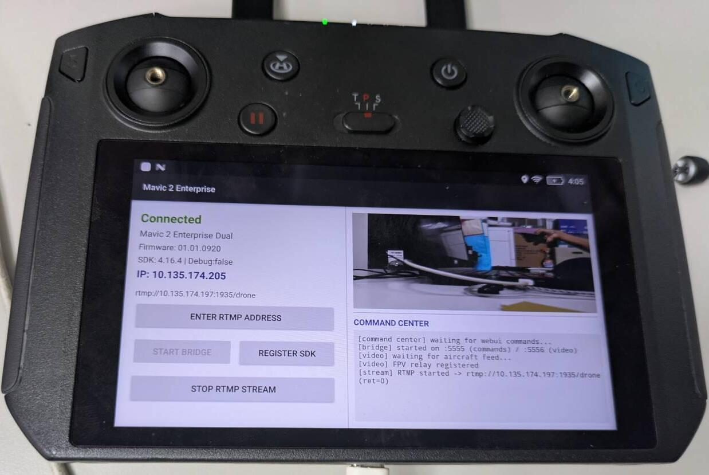
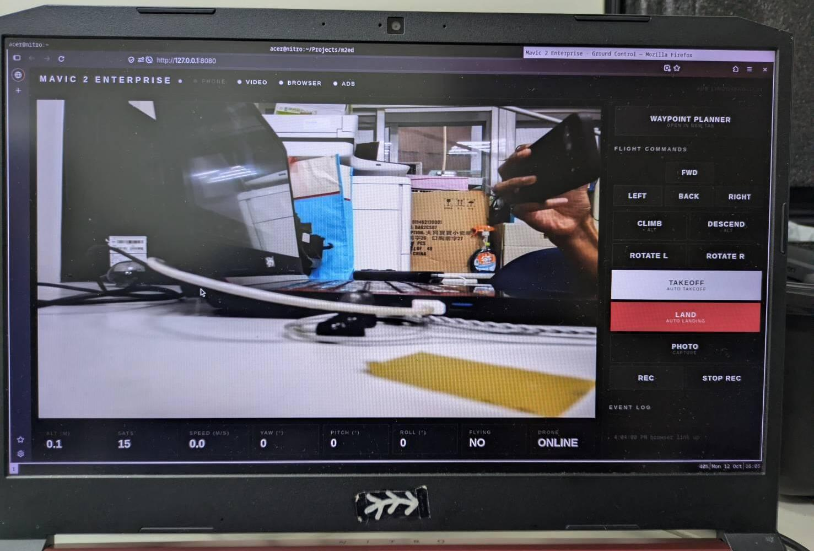
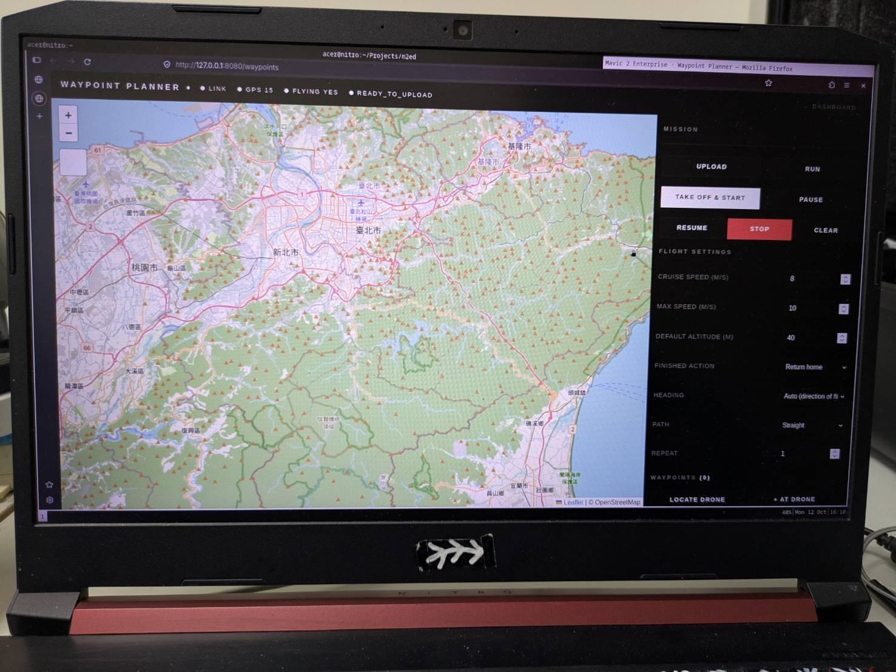

# M2ilda

An android app for the DJI Smart Controller that talks to the
aircraft through the DJI Mobile SDK. Meanwhile, a python server on a laptop exposes a
browser dashboard and a small TCP/WebSocket API for command control, telemetry,
live video, and waypoint missions.

Create your own API key at [developer.dji.com](https://developer.dji.com/) and enter it in the app on first launch.

## Steps
1. Power on the controller and aircraft; confirm they are linked.
2. Put the controller and laptop on the same Wi‑Fi network, or connect USB.
3. Open the app on the controller. Enter your API key; the app registers with DJI and shows the controller's IP address.
4. Tap **START BRIDGE** if it is not already running. The command log shows
   `[bridge] started on :5555 (commands)`.

## Live Cam
For Video streaming use: [mediamtx](https://github.com/bluenviron/mediamtx)
Video is published over RTMP to mediamtx on the laptop:

```bash
mediamtx
```

In the app, tap **ENTER RTMP ADDRESS** and set:

```
rtmp://<laptop-ip>:1935/drone
```

Tap **START RTMP STREAM**.


## App Dashboard


## webUI Dashboard


## Waypoint Dashboard

